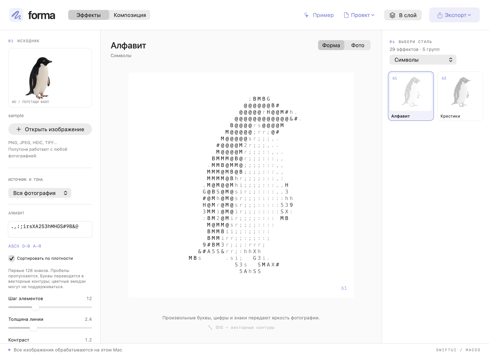
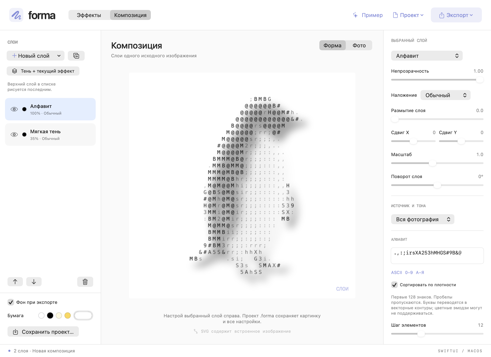

# Forma — растр в форму

Нативное macOS-приложение на SwiftUI. Загрузи изображение, выбери стиль и сохрани результат в SVG или PNG. Встроенный образец — пингвин, вырезанный из исходного референса.

29 эффектов в пяти группах: контуры и формы, растры, символы, текстуры, фото и свет. Отдельный режим композиции позволяет складывать эффекты в слои. Все вычисления выполняются локально, без сторонних библиотек.



Mac-версия находится в корне репозитория. В [iPad/](iPad/README.md) сохранён экспериментальный проект Swift Playgrounds с 14 исходными стилями и инструкцией запуска без кабеля.

## Запуск

Открой `build/Forma.app` двойным щелчком в Finder. Требуется macOS 14 или новее. Готовая сборка предназначена для архитектуры Mac, на котором запущен `build.sh`.

Сборка локальная, с ad-hoc подписью. Developer ID и нотариализация для распространения на другие Mac здесь не настроены.

Собрать заново без полного Xcode, через Command Line Tools:

```sh
cd /путь/к/Forma
./build.sh
open build/Forma.app
```

Или открой `Forma.xcodeproj` в Xcode, выбери схему **Forma**, устройство **My Mac** и нажми **⌘R**. Проект не требует аккаунта разработчика, сторонних библиотек или установки зависимостей. `Package.swift` оставлен как альтернативный способ открыть исходники; для запуска полноценного `.app` используй проект Xcode или `build.sh`.

## Как поделиться

Архив `Forma-macOS-AppleSilicon.zip` рядом с папкой проекта содержит только приложение со встроенным примером. Отправляй этот ZIP: получатель распаковывает его и переносит `Forma.app` в «Программы». Ему не нужны Xcode, Swift и исходники. Эта сборка — **arm64**, для Mac с Apple Silicon (M1 и новее), **macOS 14+**. Для Intel нужна отдельная сборка.

При загрузке из интернета Gatekeeper может заблокировать первый запуск из-за отсутствия Developer ID и нотариализации. После попытки запуска разрешить именно это приложение можно в «Системные настройки → Конфиденциальность и безопасность → Всё равно открыть». [Инструкция Apple](https://support.apple.com/ru-ru/102445). Для обычного распространения без этого шага понадобится подпись Developer ID и нотариализация.

Чтобы упаковать свою новую сборку:

```sh
ditto -c -k --sequesterRsrc --keepParent build/Forma.app ../Forma-macOS-AppleSilicon.zip
```

## Использование

1. **⌘O**, кнопка «Открыть изображение» или перетаскивание файла в окно.
2. Выбери группу и эффект справа. Номера 2–43 соответствуют исходному референсу с пингвином, 51–54 — штриховым растрам, 61–75 — новым символам, текстурам и фотоэффектам.
3. Если объект выделился плохо, настрой «Допуск фона». Уменьшение сохраняет больше пикселей; увеличение удаляет больше фона.
4. «Порог тёмного» управляет тем, какие участки входят в точки, полосы и штриховку. Больший порог включает более светлые области.
5. «Область» позволяет принудительно использовать весь силуэт или только тёмные области для любого стиля. Контур по умолчанию показывает только силуэт; «Внутренние линии контура» добавляет границы тёмных областей и может захватывать текстуру фотографии.
6. «Шаг элементов» меняет сетку и частоту штрихов; «Толщина» — линии; «Упрощение» — геометрию контуров. Параметры общие, но каждый стиль использует подходящие ему настройки.
7. «Фото / Форма» переключает исходник и результат.
8. «Экспорт» сохраняет SVG или PNG 1536 × 1536. Геометрические эффекты и буквы в SVG остаются векторными; фотоэффекты встраиваются как PNG. Отключи «Фон при экспорте», чтобы получить прозрачный фон. Цвет бумаги выбирается рядом: белый, чёрный, кремовый, жёлтый или произвольный.

**⌘⇧S** — экспорт SVG. Все файлы обрабатываются локально; приложение не использует сеть.

## Насколько это похоже на пример

Это алгоритмические интерпретации, а не восстановление авторских рисунков. Стили **2** и **3** реализованы как сглаженный контур и гексагональная сетка точек. Доступны 29 эффектов: исходные 14, четыре штриховых растра и 11 новых эффектов. Формы вроде **42** в референсе требуют дизайнерских решений: наша версия использует геометрические модули, автоматически подобранные по срезам силуэта.

| № | Стиль | Принцип |
|---|---|---|
| 2 | Контур | Трассировка границы → RDP → кубические кривые |
| 3 | Точки | Гексагональная сетка по тёмным областям |
| 11 | Овалы | Наклонные эллипсы вдоль срезов силуэта |
| 12 | Пиксели | Слитные квадратные ячейки |
| 13 | Волны | Волнообразные полосы внутри силуэта |
| 21 | Многоугольник | Сильное упрощение границы |
| 22 | Мозаика | Квадраты с зазорами |
| 23 | Ломаная | Контур с малым числом вершин |
| 31 | Штриховка | Детерминированные короткие штрихи |
| 32 | Полосы | Вертикальные срезы тёмных областей |
| 33 | Пятно | Сглаженные заполненные тёмные области |
| 41 | Кольца | Гексагональная сетка окружностей |
| 42 | Геометрия | Крупные скруглённые модули по срезам |
| 43 | Набросок | Несколько колеблющихся контуров блочной маски |
| 51 | Свечи | Вертикальные штрихи с тонкими усами; тело растёт в тёмных местах |
| 52 | Наклонный растр | Смещённая сетка наклонных прямоугольных штрихов |
| 53 | Кирпичики | Горизонтальные штрихи в шахматно смещённых рядах |
| 54 | Нити | Непрерывные полосы с толщиной, зависящей от яркости |

Силуэтные стили 2–43 рассчитаны на один объект на однотонном или прозрачном фоне. Цвет фона оценивается по краю исходного изображения, затем удаляются похожие пиксели, связанные с границей. Это не нейросетевая сегментация: сложный фон, тени и объект, занимающий весь кадр, могут требовать предварительного удаления фона. Изображение вписывается в квадрат 384 × 384 для анализа, поэтому очень мелкие детали теряются. SVG остаётся векторным; увеличение не восстанавливает потерянную детализацию.

## Новые полутона 51–54

Эти стили работают со всей фотографией и сохраняют серые полутона. Для них не нужно заранее удалять фон. В поле «Источник полутонов» оставь «Вся фотография»; варианты «Силуэт» и «Тёмные области» дополнительно ограничивают область печати старой маской.

- **Шаг элементов**: меньше — тоньше сетка и больше деталей; больше — крупнее графические элементы.
- **Толщина линии**: меняет ширину штрихов и насыщенность печати.
- **Контраст**: разводит светлое и тёмное перед построением растра.
- **Плотность**: осветляет или затемняет средние тона.
- **Поворот растра**: вращает всю сетку относительно базового направления стиля. При 0° свечи и нити вертикальны, наклонный растр повёрнут на −16°, кирпичики горизонтальны.
- **Чернила / Бумага**: чёрный на кремовом или жёлтом ближе к новым примерам; доступны и произвольные цвета.

Геометрия остаётся векторной. Сетка поворачивается, а затем обрезается по границам исходного изображения, поэтому SVG и PNG сохраняют один и тот же рисунок. Точки в самых светлых местах «Кирпичиков» и тонкие линии в светлых местах «Нитей» — часть стилизации.

### Как устроен полутоновый алгоритм

`ToneField` в `Engine.swift` вычисляет яркость из RGB, применяет контраст и кривую плотности. Затем берёт среднюю яркость в окрестности каждой ячейки повёрнутой сетки. Она определяет длину и ширину штриха. У «Нитей» ширина вычисляется непрерывно вдоль каждой полосы. Прозрачные пиксели не создают штрихов; старый порог бинаризации в режиме «Вся фотография» на полутона не влияет.

## Символы, текстуры и фото

| № | Эффект | Результат |
|---|---|---|
| 61 | Алфавит | ASCII, цифры, кириллица или свой набор знаков |
| 62 | Крестики | Сетка стежков с непрозрачностью по тону |
| 63 | Полутоновые точки | Круги переменного радиуса |
| 64 | Зерно | Повторяемая нерегулярная россыпь точек |
| 65 | Стежки | Короткие линии, огибающие перепады яркости |
| 66 | Сканлайн | Рваные горизонтальные строки и смещения |
| 71 | X-ray | Светящиеся края и полупрозрачный тон на тёмной бумаге |
| 72 | Фотограмма | Мягкий светлый отпечаток на цветной бумаге |
| 73 | Мягкая тень | Размытое тоновое пятно с прозрачным фоном |
| 74 | Фотография | Цветной исходник для подложки |
| 75 | Размытие фото | Мягкий цветной исходник |

Для «Алфавита» поле знаков находится перед ползунками. Есть пресеты ASCII, цифр и кириллицы. Можно ввести первые 128 произвольных знаков; повторы и пробелы пропускаются. По умолчанию знаки сортируются по измеренной плотности. Если выключить сортировку, порядок задаёт введённая строка — от светлого к тёмному. Используются векторные контуры Core Text: шрифт на компьютере получателя SVG не нужен. Цветные эмодзи и знаки без контуров могут не поддерживаться.

X-ray — художественная имитация по видимым краям и яркости. Он не восстанавливает скрытые прожилки, пересекающиеся лепестки и внутреннюю структуру из обычной фотографии. Фотограмма и стежки также приближают графический приём, а не физический процесс экспонирования или ручную вышивку.

Фотоэффекты анализируют рабочее изображение 384 × 384. Экспорт PNG 1536 × 1536 увеличивает его; это не восстановление мелких деталей. SVG с такими эффектами содержит встроенный растр, о чём сообщает предпросмотр.

## Композиция и слои

1. В «Эффектах» настрой изображение и нажми **«В слой»**. Откроется отдельный режим **«Композиция»**.
2. В списке слева верхний слой рисуется последним. Кнопка с глазом скрывает слой. Стрелки поднимают и опускают выбранный слой; рядом можно дублировать или удалить его.
3. Справа настраиваются эффект выбранного слоя, его цвет, непрозрачность, размытие, сдвиг, масштаб и поворот. Параметры каждого слоя независимы.
4. «Новый слой» позволяет добавить любой эффект. **«Тень + текущий эффект»** добавляет пару: полупрозрачную размытую тень внизу и текущий эффект сверху. Уже существующие слои сохраняются.
5. Доступны обычное наложение, умножение и экран. Бумага общая для всей композиции; при выключенном фоне PNG/SVG сохраняют прозрачность.
6. Все слои используют одно исходное изображение. Открытие другой картинки пересчитывает композицию для нового исходника.
7. Экспорт в этом режиме сохраняет всю композицию, включая порядок, видимость, преобразования и размытие слоёв. SVG хранит отдельные группы и фильтры; результаты размытия могут немного отличаться между SVG-просмотрщиками.



### Сохранение редактируемого проекта

**⌘S** или «Проект → Сохранить проект» создаёт файл `.forma`. Он содержит рабочие пиксели исходника и все параметры слоёв, поэтому переносится на другой Mac одним файлом. **⌘⇧O** открывает такой проект; также можно открыть его двойным щелчком в Finder. Исходный файл фотографии рядом не требуется.

Проект сохраняется вручную. PNG и SVG предназначены для готового изображения и не заменяют `.forma`, если нужно продолжить работу со слоями. В проекте хранится рабочая копия 384 × 384, а не полноразмерный оригинал фотографии.

## Как здесь устроен GUI под Mac

Для интерфейса используются **Swift** и **SwiftUI**, а для системных диалогов и работы с изображениями — **AppKit / Core Graphics**. Начни с этих файлов в таком порядке:

1. `Sources/Forma/FormaApp.swift` — точка входа и окно.
2. `Sources/Forma/ContentView.swift` — компоновка, кнопки, ползунки и предпросмотр.
3. `Sources/Forma/AppModel.swift` — состояние, открытие файлов, фоновые вычисления и экспорт.
4. `Sources/Forma/Engine.swift` — выделение объекта и стили.
5. `Sources/Forma/Geometry.swift` — общая векторная модель для экрана, SVG и PNG.
6. `Sources/Forma/Effects.swift` — текстовые контуры, текстуры, фотографические эффекты и CPU-размытие Accelerate.
7. `Sources/Forma/Composition.swift` — слои, наложение, экспорт композиции и формат проекта.
8. `Sources/Forma/LayerViews.swift` — список слоёв и общие настройки эффекта для двух режимов.

### Окно — это дерево представлений

```swift
@main
struct FormaApp: App {
    var body: some Scene {
        WindowGroup("Forma") {
            ContentView()
        }
    }
}
```

`@main` задаёт вход в приложение. `WindowGroup` создаёт системное окно. `ContentView` описывает его содержимое. Реальный вариант в проекте также передаёт модель через `.environmentObject(model)`.

Вместо ручного размещения контролов по координатам SwiftUI использует компоновку:

```swift
HStack {
    controls
    workspace
    styles
}
```

`HStack` располагает элементы горизонтально, `VStack` — вертикально. Модификаторы `.padding()`, `.frame()` и `.background()` меняют представление. `ScrollView` добавляет прокрутку. Размеры рабочего поля вычисляет `GeometryReader`.

### Состояние → интерфейс

```swift
@Published var parameters = Parameters()
```

Это свойство модели `ObservableObject`. Когда оно меняется, SwiftUI обновляет зависящие от него представления.

```swift
Slider(value: $model.parameters.spacing, in: 6...30)
```

Знак `$` создаёт **Binding**: ползунок читает значение из модели и записывает туда изменения. `.onChange(of: model.parameters)` запускает новый расчёт. `Button` работает проще: его замыкание выполняется при нажатии.

`@State` подходит для состояния внутри одного представления, например подсветки области перетаскивания. `@StateObject` создаёт модель на время жизни приложения; `@EnvironmentObject` даёт дочерним представлениям доступ к ней.

### Тяжёлая работа — вне UI

`AppModel` помечен `@MainActor`: состояние интерфейса меняется на главном потоке. Анализ пикселей и генерация стилей идут в отдельной последовательной `DispatchQueue`. Обратно на главный поток возвращается готовый результат. Номер ревизии отбрасывает устаревшие результаты; отложенные задания отменяются при новых изменениях ползунков.

### Рисование

`VectorCanvas` использует SwiftUI `Canvas`. Он берёт `CGPath` из модели и рисует их через `fill` / `stroke`. Важный приём: предпросмотр и экспорт используют одну геометрию, поэтому не нужно независимо реализовывать каждый стиль для экрана и для файла.

### Системные диалоги

В `AppModel.openImage()` используется `NSOpenPanel`, в `export()` — `NSSavePanel`. Это стандартные диалоги macOS с системным выбором папок. У SwiftUI также есть `fileImporter` / `fileExporter`; здесь выбран прямой мост к AppKit, чтобы логика файлов лежала в модели.

Документация Apple: [WindowGroup](https://developer.apple.com/documentation/swiftui/windowgroup), [Canvas](https://developer.apple.com/documentation/swiftui/canvas), [NSOpenPanel](https://developer.apple.com/documentation/appkit/nsopenpanel), [NSSavePanel](https://developer.apple.com/documentation/appkit/nssavepanel).

### Первые изменения для практики

- Поменяй цвет `accent` в `ContentView.swift` и запусти **⌘R**.
- Найди `defaultSize` в `FormaApp.swift` и поменяй размер окна.
- Добавь кнопку рядом с «Пример», вызывающую `model.reset()`.
- Добавь новое значение в `Style`, затем его название, описание и ветку `switch` в `Engine.drawing`. Карточка появится автоматически благодаря `Style.allCases`.

## Проверка алгоритмов

```sh
./build.sh
build/Forma.app/Contents/MacOS/Forma --self-test --output /tmp/forma-qa
```

Проверяются выделение фона, белая область внутри объекта, прозрачные отверстия, ориентация контуров, все 29 эффектов, корректность XML SVG, размеры и прозрачность PNG, вертикальная ориентация экспорта и повторяемость результата. Для растров отдельно проверяются различимость серых полутонов, зависимость от плотности, обрезка повёрнутой сетки, независимость от бинарного порога и цвет бумаги. Для композиции — Unicode-алфавиты, порядок и видимость слоёв, наложение, сдвиг, поворот, размытие, прозрачность, ориентация встроенного растра и восстановление пикселей и параметров из `.forma`. В указанную папку сохраняются картинки и SVG для просмотра. Эти проверки не заменяют ручную проверку системных диалогов в открытом окне.
